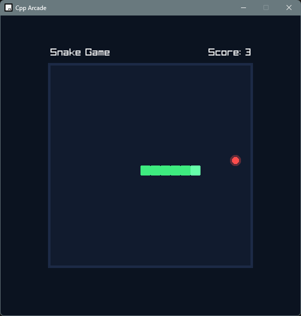
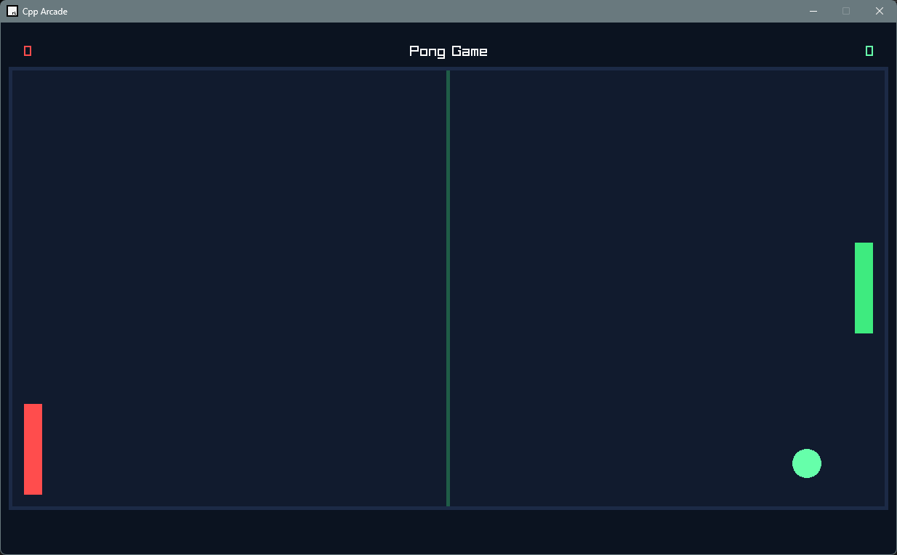
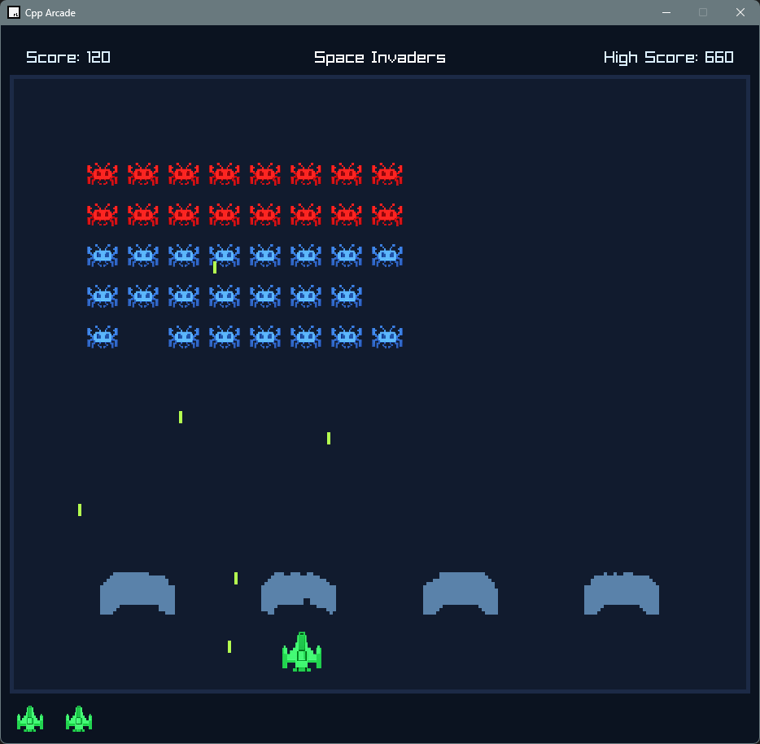
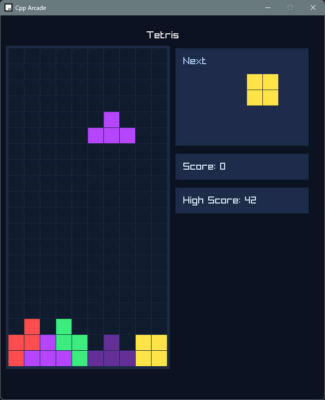

# Cpp Arcade

A collection of classic arcade games built with **C++ and Raylib**, developed as a personal project to explore game programming fundamentals and reusable game systems.

## Overview

Cpp Arcade is a collection of classic games implemented in C++. The project currently includes:

- Snake
- Pong
- Space Invaders
- Tetris

Beyond recreating these games, the project explores how common game development systems can be structured and reused across different games.

## Technical Highlights

The project includes reusable systems and components for:

- **Game Loop:** Managing the main game update and rendering cycle.
- **Input Handling:** Processing player input and controls.
- **Rendering:** Drawing game objects and visual elements.
- **Collision Detection:** Handling interactions between game objects.
- **Scene Management:** Organizing game states and transitions.

These systems provide a foundation for implementing multiple games while reducing duplicated code.

## Technologies

- C++17
- Raylib

## Project Goals

The main goal is to strengthen my understanding of C++ game programming while building a reusable foundation for developing different types of games.

## Future Plans

- Refine the existing architecture and improve code reusability.
- Explore an Entity Component System (ECS) architecture.
- Build a larger survival game inspired by the Vampire Survivors genre.

## Demo

| Snake | Pong |
|-------|------|
|  |  |

| Space Invaders | Tetris |
|-------|------|
|  |  |

## Status

Personal project — ongoing development.